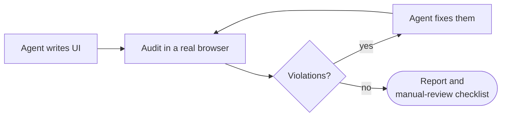

<div align="center">

<picture>
  <source media="(prefers-color-scheme: dark)" srcset="./.github/brand/a11y-loop-logo-dark.svg">
  
</picture>

# a11y-loop

### Accessible UI, checked in a real browser.

Your coding agent writes accessible UI, audits the rendered page, fixes what it finds, and tells you what it could not check.

<a href="https://ChanMeng666.github.io/a11y-loop/"></a> <a href="https://www.npmjs.com/package/a11y-loop"></a> <a href="evals/benchmark-results.md"></a> <a href="docs/overview.md#-field-notes"></a>

</div>

<br>

<a href="https://ChanMeng666.github.io/a11y-loop/"></a>

<br>

https://github.com/user-attachments/assets/33ff8672-7690-4581-9ceb-d95476883c54

## Try it

```bash
npm i -g a11y-loop
npx playwright install chromium
mkdir -p ~/.claude/skills
cp -r "$(npm root -g)/a11y-loop/skills/a11y-loop" ~/.claude/skills/
```

That is the command-line tool, its browser and the skill. Start a new agent session and ask for UI as usual: the skill applies while the agent writes it. To audit a page yourself:

```bash
a11y-loop audit http://localhost:3000
```

<sub>Every command is non-interactive, so your agent can run them for you. Claude Code also has an optional plugin: see [Getting started](docs/overview.md#-getting-started).</sub>

## Why a loop

- **Five rendering passes, not one page load.** Default, dark mode, forced colors, reduced motion and a 320 px reflow viewport, plus the states the agent built: an open modal, an expanded menu, a form error.
- **The end of the loop can be checked.** `a11y-loop diff` marks each finding FIXED, NEW or REMAINING. A new one fails the run even when the total went down.
- **It lists what it could not check.** A clean report means no automatically detectable failures were found. It is never a conformance claim. Every run comes with a manual-review checklist for what needs a person or assistive technology.



## For your agent

This page is all a person needs. Everything else is written for agents: clone the repo and point yours at [`AGENTS.md`](AGENTS.md) and [`skills/a11y-loop/SKILL.md`](skills/a11y-loop/SKILL.md), or start from [`llms.txt`](llms.txt).

<sub>[Full overview](docs/overview.md) · [Honest coverage](docs/overview.md#-honest-coverage) · [Using it in CI](docs/overview.md#%EF%B8%8F-using-it-in-ci) · [Changelog](CHANGELOG.md) · [Contributing](CONTRIBUTING.md) · [Third-party notices](THIRD-PARTY-NOTICES.md) · [MIT](LICENSE)</sub>

<sub>Built by [Chan Meng](https://github.com/ChanMeng666).</sub>
