<div align="center">

<picture>
  <source media="(prefers-color-scheme: dark)" srcset="./.github/brand/a11y-loop-logo-dark.svg">
  
</picture>

# a11y-loop

### Accessible UI, checked in a real browser.

Your coding agent writes accessible UI, audits the rendered page, fixes what it finds, and tells you what it could not check.

<a href="https://ChanMeng666.github.io/a11y-loop/"></a> <a href="https://www.npmjs.com/package/a11y-loop"></a> <a href="evals/benchmark-results.md"></a> <a href="docs/overview.md#-field-notes"></a>

<sub>English · [简体中文](README.zh-CN.md)</sub>

</div>

<br>

<a href="https://ChanMeng666.github.io/a11y-loop/"></a>

<br>

https://github.com/user-attachments/assets/33ff8672-7690-4581-9ceb-d95476883c54

## Try it

**1. The skill, for any agent that reads Agent Skills** (Claude Code, Codex, Cursor, Copilot, Gemini CLI and others):

```bash
npx skills add ChanMeng666/a11y-loop -g -y
```

**2. The command-line tool and its browser** (the audit needs both):

```bash
npm i -g a11y-loop
a11y-loop install-browser   # downloads Chromium for a11y-loop's own Playwright (~700 MB on disk)
a11y-loop doctor            # checks Node, the browser and where the skill is installed
```

Start a new agent session and ask for UI as usual. The skill applies while the agent plans and writes it. To audit a page yourself:

```bash
a11y-loop audit http://localhost:3000
```

### Claude Code: the plugin instead of step 1

The plugin carries the skill, a `/a11y-plan` command and a plan-mode hook. Install the plugin **or** the skill, not both.

```text
/plugin install a11y-loop --marketplace ChanMeng666/a11y-loop
```

From a terminal (Claude Code 2.1.292 or later):

```bash
claude plugin install a11y-loop --marketplace ChanMeng666/a11y-loop
```

Older versions:

```bash
claude plugin marketplace add ChanMeng666/a11y-loop
claude plugin install a11y-loop@chanmeng-a11y-loop --scope user
```

You still need step 2 for the audit.

### Codex: the plugin

```bash
codex plugin marketplace add ChanMeng666/a11y-loop
codex plugin add a11y-loop@chanmeng-a11y-loop
```

### Windows

Step 1 and step 2 work as written in PowerShell, Windows PowerShell and Git Bash. The `npx skills` installer is the cross-platform way to add the skill. If you copy the skill by hand instead, use the variant for your shell. Re-running it upgrades in place.

PowerShell:

```powershell
New-Item -ItemType Directory -Force "$HOME\.claude\skills" | Out-Null
Copy-Item -Recurse -Force "$(npm root -g)\a11y-loop\skills\a11y-loop" "$HOME\.claude\skills\"
```

Git Bash, macOS, Linux:

```bash
mkdir -p ~/.claude/skills
cp -r "$(npm root -g)/a11y-loop/skills/a11y-loop" ~/.claude/skills/
```

cmd.exe is not supported for these commands. Use PowerShell.

If you keep browsers off the system drive, set `PLAYWRIGHT_BROWSERS_PATH` before `a11y-loop install-browser` and keep it set when you audit.

### What it runs on your machine

- **The skill** is text. It runs nothing by itself.
- **The plugin's hook** runs `node hooks/plan-gate.mjs` before Claude Code leaves plan mode. It reads the plan text and writes one small state file to Claude Code's plugin data directory (or the temp directory). It makes no network requests. Turn it off with `A11Y_LOOP_PLAN_GATE=off`.
- **The command-line tool** is a separate install (`npm i -g a11y-loop`). It launches a local Chromium, serves `--file` and `--html` targets on a localhost port, and opens only the URL you give it. It sends no telemetry.
- **`a11y-loop install-browser`** downloads Chromium and a headless shell from Playwright's CDN, about 700 MB on disk.
- **In claude.ai chat**, only the skill's rules apply. There is no Node or browser there, so the audit cannot run and the hook does not load.

A clean audit means no automatically detectable failures were found in the states and passes that ran. It is not a conformance claim. Every run ends with a checklist of what still needs a person.

## Why a loop

- **Five rendering passes, not one page load.** Default, dark mode, forced colors, reduced motion and a 320 px reflow viewport, plus the states the agent built: an open modal, an expanded menu, a form error.
- **The end of the loop can be checked.** `a11y-loop diff` marks each finding FIXED, NEW or REMAINING. A new one fails the run even when the total went down.
- **It lists what it could not check.** A clean report means no automatically detectable failures were found. It is never a conformance claim. Every run comes with a manual-review checklist for what needs a person or assistive technology.


## For your agent

This page is all a person needs. Everything else is written for agents: clone the repo and point yours at [`AGENTS.md`](AGENTS.md) and [`skills/a11y-loop/SKILL.md`](skills/a11y-loop/SKILL.md), or start from [`llms.txt`](llms.txt).

<sub>[Full overview](docs/overview.md) · [Honest coverage](docs/overview.md#-honest-coverage) · [Using it in CI](docs/overview.md#%EF%B8%8F-using-it-in-ci) · [Changelog](CHANGELOG.md) · [Contributing](CONTRIBUTING.md) · [Third-party notices](THIRD-PARTY-NOTICES.md) · [MIT](LICENSE)</sub>

<sub>Built by [Chan Meng](https://github.com/ChanMeng666).</sub>
