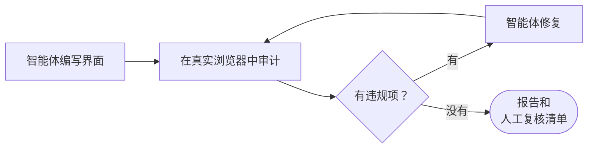

<div align="center">

<picture>
  <source media="(prefers-color-scheme: dark)" srcset="../.github/brand/a11y-loop-logo-dark.svg">
  
</picture>

# a11y-loop

### 无障碍的界面，在真实浏览器里检查。

你的编码智能体编写无障碍的界面，审计渲染后的页面，修复发现的问题，并告诉你它没能检查什么。

[English](../README.md) · 简体中文

<a href="https://ChanMeng666.github.io/a11y-loop/"></a> <a href="https://www.npmjs.com/package/a11y-loop"></a> <a href="../evals/benchmark-results.md"></a> <a href="overview.md#-field-notes"></a>

</div>

<br>

## 试一试

**1. 技能，适用于任何能读取 Agent Skills 的智能体**（Claude Code、Codex、Cursor、Copilot、Gemini CLI 等）：

```bash
npx skills add ChanMeng666/a11y-loop -g -y
```

**2. 命令行工具及其浏览器**（审计两者都需要）：

```bash
npm i -g a11y-loop
a11y-loop install-browser   # 为 a11y-loop 自带的 Playwright 下载 Chromium 无头 shell（磁盘占用约 280 MB）
a11y-loop doctor            # checks Node, the browser and where the skill is installed
```

开启一个新的智能体会话，像平常一样请它写界面。智能体在规划和编写界面的过程中，技能就会生效。不在 Claude Code 计划模式中的智能体（Codex、Cursor、Copilot、CI）在构建界面之前运行 `a11y-loop plan-check --file plan.md`；当一个界面计划没有写明任何无障碍决策时，它以退出码 1 结束。想自己审计一个页面：

```bash
a11y-loop audit http://localhost:3000
```

只支持 MCP 的客户端：`a11y-loop mcp` 通过 stdio 把审计、diff、对比度、plan-check、doctor 命令和人工检查清单作为六个 MCP 工具提供（[设置方法](overview.md#mcp-server)）。

GitHub Actions：`uses: ChanMeng666/a11y-loop@v0.4.1` 在 CI 中审计，并把结果写入作业摘要（[GitHub Marketplace](https://github.com/marketplace/actions/a11y-loop-audit)，[设置方法](overview.md#%EF%B8%8F-using-it-in-ci)）。

### Claude Code：用插件代替第 1 步

插件包含技能、一个 `/a11y-plan` 命令和两个钩子：一个要求界面计划写明无障碍部分，另一个要求改动过界面的会话在结束前运行审计。插件和技能只装其中一个，不要两个都装。钩子只在 Claude Code 中运行；[其他客户端和 CI](agent-gates.md) 有各自的途径来做同样的计划检查和审计检查。

```text
/plugin install a11y-loop --marketplace ChanMeng666/a11y-loop
```

在终端中安装（需要 Claude Code 2.1.292 或更高版本）：

```bash
claude plugin install a11y-loop --marketplace ChanMeng666/a11y-loop
```

较旧的版本：

```bash
claude plugin marketplace add ChanMeng666/a11y-loop
claude plugin install a11y-loop@chanmeng-a11y-loop --scope user
```

审计仍然需要第 2 步。

### Codex：插件

```bash
codex plugin marketplace add ChanMeng666/a11y-loop
codex plugin add a11y-loop@chanmeng-a11y-loop
```

### Windows

第 1 步和第 2 步在 PowerShell、Windows PowerShell 和 Git Bash 中都可以照原样运行。`npx skills` 安装器是跨平台添加技能的方式。如果你想手动复制技能，请使用与你的 shell 对应的写法。重新运行会就地升级。

PowerShell：

```powershell
New-Item -ItemType Directory -Force "$HOME\.claude\skills" | Out-Null
Copy-Item -Recurse -Force "$(npm root -g)\a11y-loop\skills\a11y-loop" "$HOME\.claude\skills\"
```

Git Bash、macOS、Linux：

```bash
mkdir -p ~/.claude/skills
cp -r "$(npm root -g)/a11y-loop/skills/a11y-loop" ~/.claude/skills/
```

这些命令不支持 cmd.exe，请使用 PowerShell。

如果你把浏览器放在系统盘之外，请在运行 `a11y-loop install-browser` 之前设置 `PLAYWRIGHT_BROWSERS_PATH`，并在审计时保持该设置。

### 它在你的机器上运行什么

- **技能**是文本，自身不运行任何东西。
- **插件的计划钩子**在 Claude Code 离开计划模式之前，从插件自己的文件夹运行 `node hooks/plan-gate.mjs`。它读取计划文本，并向 Claude Code 的插件数据目录（或临时目录）写入一个很小的状态文件。它不发出任何网络请求。可用 `A11Y_LOOP_PLAN_GATE=off` 关闭。
- **插件的审计钩子**在 Claude 即将结束时运行 `node hooks/audit-gate.mjs`。它读取 Claude Code 本来就保存的会话记录，查找界面文件的修改和审计命令，并向同一个目录写入一个很小的状态文件。它自己不运行审计，也不发出任何网络请求。可用 `A11Y_LOOP_AUDIT_GATE=off` 关闭。
- **安装插件**只会把仓库的 `plugin/` 文件夹复制到 Claude Code 的插件缓存中，不下载任何包。0.3.0 及更早版本把整个仓库当作插件，因此安装时还会在缓存里运行 `npm ci`，下载约 24 MB 插件用不到的包。
- **命令行工具**是单独安装的（`npm i -g a11y-loop`）。它会启动本地的 Chromium，在本机端口上为 `--file` 和 `--html` 目标提供服务，并且只打开你给出的 URL。它不发送任何遥测数据。
- **`a11y-loop install-browser`** 从 Playwright 的 CDN 下载 Chromium 无头 shell，磁盘占用约 280 MB；加 `--full` 才会同时安装完整的 Chromium（合计约 715 MB），只有 `audit --headed` 需要它。
- **在 claude.ai 聊天中**，只有技能的规则生效。那里没有 Node 或浏览器，所以审计无法运行，钩子也不会加载。

审计结果干净只表示在已运行的状态和渲染轮次中没有发现可被自动检测出来的问题。它不是符合性声明。每次运行都会以一份清单收尾，列出仍然需要人来检查的事项。

它不收集任何数据，也不向作者发送任何内容。参见 [PRIVACY.md](../PRIVACY.md)。

## 为什么是一个循环

- **五个渲染轮次，而不是一次页面加载。** 默认、深色模式、强制颜色、减少动态效果，以及 320 px 的重排视口，再加上智能体构建出的各种状态：打开的模态框、展开的菜单、表单错误。
- **循环的终点可以被检查。** `a11y-loop diff` 把每个发现标记为 FIXED、NEW 或 REMAINING。即使总数下降了，只要出现一个新的发现，这次运行也算失败。
- **它会列出它没能检查的内容。** 审计结果干净只表示没有发现可被自动检测出来的问题。它从来不是符合性声明。每次运行都附带一份人工复核清单，列出需要人或辅助技术来检查的事项。



## 给你的智能体

对人来说，这一页就够了。其余内容都是写给智能体的：克隆仓库，让你的智能体读取 [`AGENTS.md`](../AGENTS.md) 和 [`skills/a11y-loop/SKILL.md`](../skills/a11y-loop/SKILL.md)，或者从 [`llms.txt`](../llms.txt) 开始。

<sub>[完整概览](overview.md) · [如实的覆盖范围](overview.md#-honest-coverage) · [在 CI 中使用](overview.md#%EF%B8%8F-using-it-in-ci) · [更新日志](../CHANGELOG.md) · [贡献指南](../CONTRIBUTING.md) · [第三方声明](../THIRD-PARTY-NOTICES.md) · [MIT](../LICENSE)</sub>

<sub>作者 [Chan Meng](https://github.com/ChanMeng666)。以上链接指向的文档均为英文。</sub>
